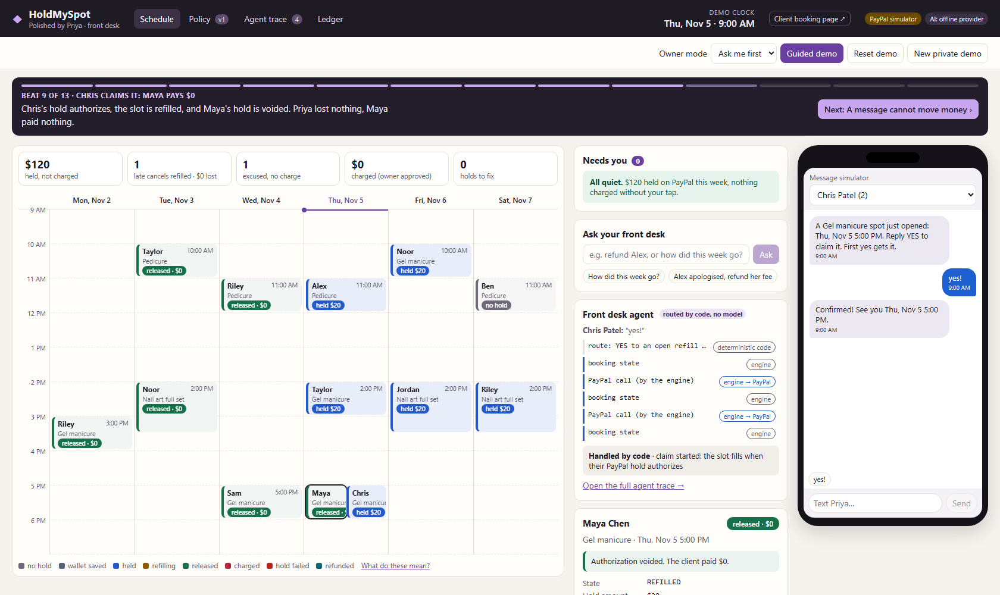

# HoldMySpot

**Fair, without the fight.** An AI front desk for solo appointment pros (nail techs, barbers, tutors) who book by text or Instagram DM. It turns a plain-English cancellation policy into rules, holds the fee with PayPal before each visit, reads "can't make it" messages, and tries to refill the slot from the waitlist before anyone is charged.

> Status: work in progress for the PayPal "Build What's Next with PayPal and AI" hackathon. Runs end to end on a deterministic PayPal sandbox simulator; the real PayPal sandbox adapter is written and tested against recorded HTTP, pending sandbox keys.



## Run it in 5 minutes

```bash
npm install
npm run demo             # builds the web app, starts http://127.0.0.1:18080 (no keys needed)
npm test                 # server tests, incl. end-to-end tests over a real HTTP server
npm run ui-check         # headless browser: plays the guided demo, axe accessibility checks, refreshes docs/screenshots
npm run eval             # message reader / injection / waitlist evals
```

Open `http://127.0.0.1:18080/?demo=1` for the **guided demo**: 13 beats, about 3 minutes, one press of → per beat (or `&autoplay=12`). The video script is in [`docs/DEMO_SCRIPT.md`](docs/DEMO_SCRIPT.md). `/book?ws=demo` is the client booking page. Or walk it yourself with the time-travel buttons:

| Scene | What happens |
|---|---|
| Tue 2:00 PM · Jordan's T−72h hold | The merchant-initiated hold is declined (sandbox negative test). Jordan's event turns red and he gets a re-approval link: we find out 3 days early. Approve it from his booking panel and it turns blue. |
| Wed 9:00 AM · Sam texts | "kiddo threw up" → classified, policy says excused → one-tap card → hold voided, new slots offered. |
| Thu 9:00 AM · Maya texts | Late cancel → refill first. Offer goes to the top 3 waitlisters. Eli says YES but his hold is declined, so the spot stays open; Chris says YES, his hold authorizes, Maya's hold is voided. **Late cancel. $0 lost. $0 charged.** |
| Thu 11:10 AM · did Alex show? | Owner taps No-show → nobody to refill → capture card → one tap captures $20. Refund is one more tap. |

Every booking has a money timeline: AI outputs, engine decisions, PayPal calls and webhooks.

## Architecture

```
 Booking page ──┐                          ┌─ PaymentsGateway
 Message sim ───┼─► Fastify API ─► Engine ─┤    ├─ MockPayPalGateway (deterministic sandbox simulator)
 Owner console ─┘    (+ SSE)       (decides │    └─ PayPalRestGateway (Orders v2 intent=AUTHORIZE, Payments v2)
                                   & calls) │
                        FrontDesk (AI) ◄────┘   LlmProvider: FakeLlmProvider | AnthropicProvider
                        labels + text only
```

- `server/src/domain` – booking state machine, policy rules, `decide()`, capture invariants.
- `server/src/engine/engine.ts` – the only caller of the payments gateway.
- `server/src/ai` – the front desk. It returns labels and text. A test fails the build if any AI module imports the payments or engine code.
- `server/src/paypal` – the gateway interface, the simulator, the real REST adapter.
- `web/` – React + Vite owner console and booking page.

### Where we refused to use AI
- **Money.** The AI has no amount, authorization or PayPal parameter anywhere in its output schemas. The engine decides; every capture needs an owner tap.
- **Matching.** Which waitlisters can take a slot is a deterministic filter (`slotMatches`); the AI only parses free text and ranks the filtered list.
- **The client-facing policy summary** is generated by code from the approved rules, and its hash is stored on every booking.

### Engine invariants
Capture ≤ authorized amount; ≤ policy maximum; never below the confidence threshold; never on emergency/medical/bereavement without the owner; every capture needs an owner tap; silence never charges (unanswered attendance becomes "Needs review"); every PayPal write carries a `PayPal-Request-Id`; duplicate webhooks are logged and ignored.

### Failure paths handled
T−72h hold declined → re-approval link · late cancel before any hold exists → same refill-first path, fee waived automatically if unfilled · refill claimer declined → next candidate · duplicate webhook ignored · low-confidence message → clarifying question · prompt injection → zero money effect (measured: `npm run eval`) · capture after the 3-day honor period → reauthorize first, honest error if refused.

## Configuration
See `.env.example`. `PAYMENTS=sandbox` + `PAYPAL_CLIENT_ID/SECRET` uses real PayPal sandbox. `AI=anthropic` + `ANTHROPIC_API_KEY` uses Claude (`claude-sonnet-5-5` by default) with structured outputs. `server/src/scripts/sandbox-smoke.ts` runs the Day-1 PayPal spikes.

## Not built yet (honest list)
Agent Toolkit `create_refund`/`list_transactions`; Bryntum Scheduler (licence check pending; hand-built week grid for now); policy-compiler eval on 15 real policies; persistence (state is in memory per demo workspace).

## Tools
- PayPal Orders v2 (intent=AUTHORIZE, merchant-initiated with `vault_id` + `stored_credential`), Payments v2 (capture, void, reauthorize, refund), Vault v3 (setup token → payment token for bookings more than 72h out), webhooks (signature-verified; the endpoint refuses events when no `PAYPAL_WEBHOOK_ID` is configured).
- Claude (Anthropic API) for policy compilation, message classification, waitlist parsing/ranking and reply drafting, behind a provider interface with a deterministic fake for tests and keyless demos.

## Licence
MIT, see `LICENSE`.
